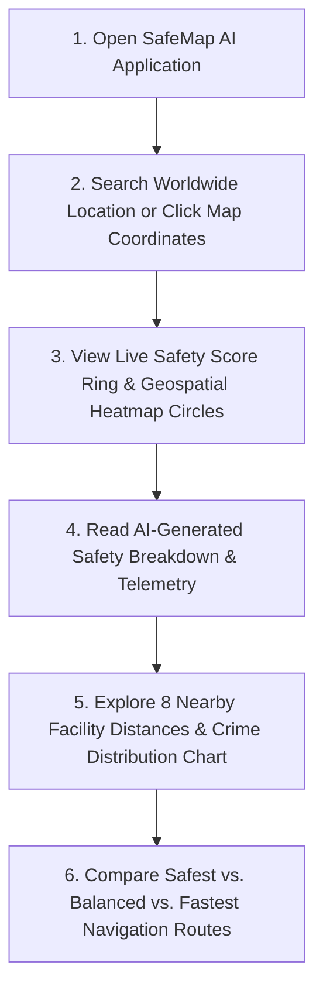

# Chapter 4: UI/UX Design & Architecture Specification
**Project Title:** SafeMap AI — Real-Time Geospatial Crime Heatmap & AI Safety Prediction System  
**Document Type:** Software Requirements Specification (SRS) — UI/UX Chapter  

---

## 4.1 User Interface (UI) Design Philosophy

SafeMap AI follows a modern, clean, and minimal design philosophy inspired by **Google Maps, Apple Maps, Uber, Airbnb, and Notion**. The interface is designed to help users quickly understand the safety of any location without unnecessary complexity. Every screen prioritizes clarity, accessibility, and ease of navigation.

The application uses a **map-first layout** where the interactive Leaflet map occupies the entirety of the viewport (`100vw × 100vh`), allowing users to search, explore, and analyze locations naturally. Essential information such as safety scores, crime statistics, AI-generated insights, and nearby emergency services is displayed through floating cards, glassmorphic overlays, and side panels that do not obstruct the map.

### Visual Palette & Signaling
The color palette is carefully chosen to communicate information effectively:
- **White (#FFFFFF)** and **Light Gray (#F5F5F5)** for crisp backgrounds and elevated cards.
- **Primary Blue (#2563EB)** for primary actions, active tabs, and navigation links.
- **Safe Green (#22C55E)** for high safety zones (Score 80–100).
- **Warning Yellow (#EAB308)** for moderate transit zones (Score 60–79).
- **Moderate Orange (#F97316)** for caution/alert zones (Score 40–59).
- **High Risk Red (#EF4444)** for dangerous/critical crime hotspots (Score < 40).

The interface uses consistent typography (`Inter` font family), rounded corners (`rounded-2xl`, `rounded-3xl`), subtle drop shadows (`shadow-xl`, `shadow-2xl`), clean spacing, and smooth micro-animations (`panel-in`, `pop-in`) to create a professional appearance while maintaining excellent readability.

---

## 4.2 User Experience (UX) Design Workflow

The user experience is designed to be **intuitive, fast, and efficient**. Users can begin interacting with the application immediately without requiring technical knowledge. The overall workflow minimizes the number of clicks required to access important information.

### Primary User Journey (6-Step Interaction Loop)


All important information is presented using visual indicators, icons (Lucide icons), color-coded risk levels, and concise summaries, enabling users to make quick travel decisions.

---

## 4.3 Design Principles

The SafeMap AI interface is designed according to the following core principles:
1. **Simple and Uncluttered Interface**: Only contextual controls appear on screen; deep analytics and modals appear on demand.
2. **Professional and Modern Appearance**: Employs contemporary glassmorphic containers (`backdrop-blur-md bg-white/90`) and high-contrast badges.
3. **Map-Centric Design**: The Leaflet basemap is the primary canvas; widgets float above it without blocking geospatial awareness.
4. **Responsive Across Desktop, Tablet, and Mobile Devices**: Adapts from multi-column desktop floating panels to sleek touch-friendly mobile bottom sheets.
5. **Fast Loading and Smooth Interaction**: Optimized Vite React bundle (`< 500 KB gzip`) with instant client-side state transitions.
6. **Consistent Navigation Throughout the Application**: Standardized search header, layer controls, and modal close triggers.
7. **High Readability with Proper Spacing and Typography**: High contrast ratios (`#1F2937` dark text on light backgrounds) and clear hierarchy.
8. **Minimal Learning Curve for First-Time Users**: Familiar auto-complete search bar and clickable map markers.
9. **Accessibility-Focused Design**: Keyboard navigation support, clear focus rings, screen reader labels, and distinct color-blind-friendly contrast bands.

---

## 4.4 Layout Structure

The application layout consists of five core structural sections:

```
+-----------------------------------------------------------------------------+
|  [Logo: SafeMap AI]   [Worldwide Search Bar: Tokyo/London/Coimbatore]   [AI]|  <-- Top Navigation Bar
+-----------------------------------------------------------------------------+
|                                                                             |
|                                                                 +-----------+
|                                                                 |           |
|                          MAIN MAP AREA                          |   RIGHT   |
|               (Interactive Leaflet Map Canvas)                  |   SIDE    |
|                                                                 |   PANEL   |
|            [Heatmap Circles]     [Crime Markers]                |           |
|                                                                 | (Score,   |
|                                                                 |  Facilities|
|                                                                 |  & Routes)|
|  +-----------------------+                                      |           |
|  | Bottom Layer Controls |                 [ + Add Report Here ]|           |
|  +-----------------------+                                      +-----------+
+-----------------------------------------------------------------------------+
```

1. **Top Navigation Bar**: Application logo, worldwide OpenStreetMap geocoded search bar, category filter pills, basemap switcher, Analytics modal button, Ask AI assistant drawer, and notification alerts.
2. **Main Map Area**: Interactive Leaflet basemap (`Voyager`, `Light`, `Dark`, `OSM`), colored safety heatmap circle overlays, custom SVG location markers, and user-dropped report pins.
3. **Floating Information Card**: Quick-glance category badges, location name, coordinates, real-time safety trend indicator, and score band.
4. **Right Side Panel** (Desktop) / **Bottom-Sheet Drawer** (Mobile): Comprehensive location intelligence including the 7-category safety breakdown (`Women`, `Night`, `Child`, `Tourist`, etc.), 6-category crime distribution chart, and 8 nearby emergency facility distances (`Police`, `Hospital`, `Fire`, `ATM`, etc.).
5. **Bottom Status Bar / Layer Controls**: Map layer toggles (`Safety Heatmap Circles`, `Verified Community Reports`), live API readiness pulse indicator, and the floating `+ Add Report Here` action button.

---

## 4.5 User Interface Components

The application includes the following reusable, component-driven React UI elements:
- **Navigation Bar** (`TopHeader.jsx`): Responsive header with branding and action shortcuts.
- **Search Box with Auto-Complete** (`TopHeader.jsx`): Live Nominatim REST geocoding autocomplete dropdown with real-time score pills.
- **Interactive Map** (`LiveMap.jsx`): Map container handling pan/zoom and basemap tile switching.
- **Heatmap Layer** (`LiveMap.jsx`): Dynamic SVG circle overlays colored by safety score band.
- **Location Marker** (`LiveMap.jsx`): Custom glowing pin icons with interactive click handlers.
- **Floating Safety Card & Side Information Panel** (`LocationSidePanel.jsx`): Multi-section intelligence drawer with animated SVG score ring.
- **Risk Meter** (`ScoreRing` component): Circular progress SVG visualizer displaying 0–100 scores.
- **Crime Statistics Cards** (`LocationSidePanel.jsx`): Progress bars representing theft, robbery, harassment, and assault percentages.
- **Analytics Charts** (`AnalyticsModal.jsx`): 30-day city-wide crime trend charts and district ranking cards.
- **Notification Panel** (`AlertsPopover.jsx`): Live alert feed showing recent safety bulletins and high-risk area warnings.
- **Community Report Form** (`ReportModal.jsx`): 2-click modal for users to report street lighting, suspicious activity, or police presence.
- **AI Chat Assistant** (`AiChatDrawer.jsx`): Slide-over conversational interface powered by the backend safety NLP engine.
- **Loading Indicators** (`Loader2` spinners): Subtle spinners during live geocoding and API fetches.

---

## 4.6 Color Theme Specification

| Element | Color Name | Hex Code | Usage & Context |
| :--- | :--- | :--- | :--- |
| **Background** | Primary White | `#FFFFFF` | Modal containers, side panel cards, dropdown menus |
| **Secondary Background** | Light Slate Gray | `#F5F7FA` | Table headers, muted badge backgrounds, filter pill rows |
| **Primary Color** | Royal Blue | `#2563EB` | Active buttons, primary brand icon, route lines |
| **Success / Safe** | Emerald Green | `#22C55E` | Safe zones (80–100), safest route badges, police markers |
| **Warning / Moderate** | Amber Yellow | `#EAB308` | Moderate transit zones (60–79), caution alerts |
| **Moderate Risk** | Orange | `#F97316` | High-risk areas (40–59), poor lighting reports |
| **High Risk / Danger** | Crimson Red | `#EF4444` | Dangerous hotspots (< 40), emergency SOS buttons |
| **Text Primary** | Dark Gray | `#1F2937` | Main headings, location titles, body copy |
| **Borders** | Border Gray | `#E5E7EB` | Subtle card dividers, input borders, glass edges |

---

## 4.7 Typography Specification

The application implements a strict typographic scale using the **Inter** font family (with **Space Grotesk** for numerical scores and **JetBrains Mono** for technical telemetry):

```css
font-family: 'Inter', system-ui, -apple-system, sans-serif;
```

- **Heading (Page & Modal Titles)**: `28px – 36px` (`font-bold`, `tracking-tight`, `#1F2937`)
- **Subheading (Section Headers & Location Names)**: `20px – 24px` (`font-bold`, `leading-snug`)
- **Body Text (AI Summaries & Descriptions)**: `16px` (`font-normal`, `leading-relaxed`, `#4B5563`)
- **Small Text (Metadata & Distances)**: `14px` (`font-medium`, `#6B7280`)
- **Button Text (Action Labels)**: `15px – 16px` (`font-bold`, `uppercase/tracking-wide`)

---

## 4.8 Responsive Breakpoints & Device Behavior

The application is fully responsive and optimized across four standard viewport tiers:

| Viewport Tier | Breakpoint | Component Behavior & Adaptation |
| :--- | :--- | :--- |
| **Desktop / Widescreen** | `>= 1280px (xl)` | Single-row floating header; `450px` full-height right panel; floating controls at `bottom-6`. |
| **Laptop / Tablet Landscape** | `1024px – 1280px (lg)` | Compact search bar (`w-96`); full-height right panel (`w-[430px]`); scrollable category pills. |
| **Tablet Portrait** | `768px – 1024px (md)` | 2-row top navigation; right-side panel (`w-[400px]`); touch-optimized buttons. |
| **Mobile Phones** | `< 768px (sm / xs)` | **3-row header** with 100% full-width search input; **Bottom-Sheet Drawer** (`max-h-[62vh]`) with swipe handle; map layer controls dynamically elevate to `bottom-[65vh]` to prevent overlap. |

---

## 4.9 Accessibility (a11y) & Usability Best Practices

- **WCAG 2.1 AA Color Contrast**: All text elements exceed a `4.5:1` contrast ratio against backgrounds.
- **Keyboard Navigation Support**: All interactive buttons, search inputs, and modal close buttons can be focused via `Tab` and triggered via `Enter`/`Space`.
- **Screen Reader Compatibility**: Uses semantic HTML5 (`<header>`, `<nav>`, `<main>`, `<button>`, `<label>`) with descriptive `aria-label` and `title` attributes on icon buttons.
- **Touch-Friendly Hit Targets**: All mobile buttons and filter pills maintain a minimum tap target size of `44px × 44px`.

---

## 4.10 Expected User Experience Summary

SafeMap AI provides users with a **seamless, high-confidence, and informative experience** where they can quickly assess the safety of any location worldwide. The combination of an interactive Leaflet map, live OpenStreetMap geocoding, deterministic AI safety scoring, visual risk indicators, and nearby emergency facility data enables users to make informed travel decisions in seconds.

The overall design emphasizes **simplicity, professionalism, responsiveness, and usability**, ensuring that the application feels like a modern commercial product rather than a typical academic prototype.
